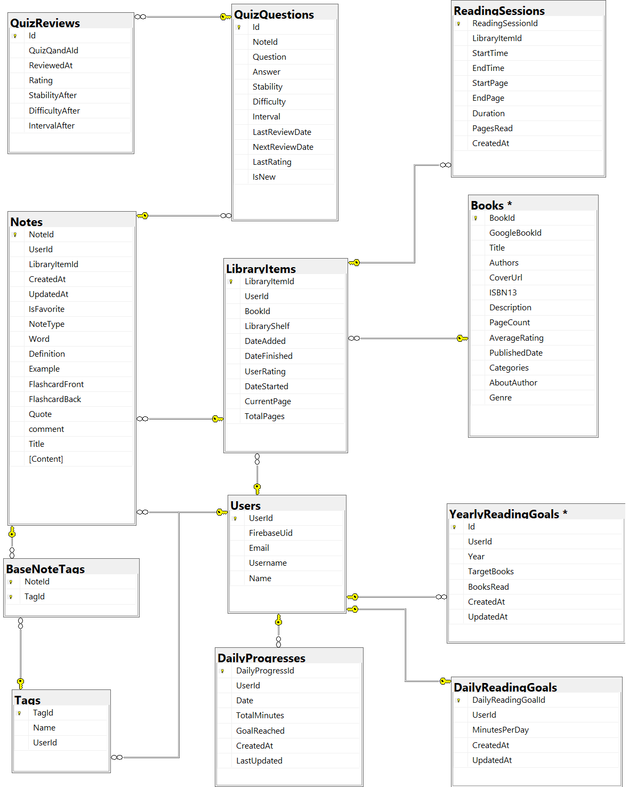

# 📚 Make It Stick - AI-Powered Active Reading & Learning Mobile Platform

[](https://reactnative.dev/)
[](https://dotnet.microsoft.com/)
[](https://docs.microsoft.com/en-us/ef/)
[](https://www.microsoft.com/en-us/sql-server)
[](https://firebase.google.com/docs/auth)
[](https://python.org/)
[](https://huggingface.co/)
> **Ever wondered why you can remember every TikTok you watched last week, but forget what you read yesterday? Make It Stick fixes that.**
> **Transform passive reading into active learning with AI-powered tools that make knowledge stick.**

## 🎯 What is Make It Stick?

Imagine if your phone could actually make you **smarter** instead of just entertaining you. **Make It Stick** is a mobile app that transforms how you read, learn, and remember information. It's like having a personal AI tutor, study buddy, and reading coach all rolled into one.

**The core idea is simple:** Turn every book into an interactive learning experience that actually sticks in your memory.

### 🔥 The Problem We All Face

We live in the age of **infinite scroll and 15-second attention spans**. You know the feeling:

📖 **You read an amazing book** → 💭 **Feel inspired and enlightened** → ⏰ **Two weeks later** → 🤷‍♀️ **Remember almost nothing**

**Why does this happen?** Your brain treats most reading like passive entertainment, similar to watching TV. Without active engagement, even the best insights simply... disappear.

**The real problem isn't that you can't read - it's that traditional reading is fundamentally passive.** Your brain processes it, enjoys it, then forgets it because there's no reason to retain it.

### ✨ How Make It Stick Changes Everything

Instead of just reading books, **Make It Stick turns you into an active learner** who builds a personal knowledge system with:

🧠 **Active Recall & Spaced Repetition** - Automated flashcard generation with FSRS algorithm  
🤖 **AI-Powered Organization** - Smart tagging and semantic search through your personal knowledge  
📱 **Seamless Integration** - From reading tracker to AI tutor, everything in one app  
📊 **Data-Driven Insights** - Personal analytics that reveal your learning patterns  
🔍 **Intelligent Discovery** - Semantic book recommendations based on your interests and mood  

**The result?** Instead of reading 20 books and remembering fragments, you read fewer books but actually **internalize and apply** what you learn.

## 🏗️ Architecture Overview

This isn't just an app - it's a complete learning ecosystem built on three interconnected components:

```
┌─────────────────┐    ┌─────────────────┐    ┌─────────────────┐
│  📱 Mobile App  │◄──►│  🔧 API Server │◄──►│ 🤖 AI Services  │
│                 │    │                 │    │                 │
│ React Native    │    │ ASP.NET Core    │    │ Python/FastAPI  │
│ • Reading UI    │    │ • REST APIs     │    │ • ML Models     │
│ • Progress      │    │ • Database      │    │ • NLP Pipeline  │
│ • Statistics    │    │ • Auth System   │    │ • Embeddings    │
└─────────────────┘    └─────────────────┘    └─────────────────┘
```

## 🚀 Key Features That Make It Special

### 📖 **Smart Reading Experience**
- **Real-time session tracking** with automatic progress updates
- **OCR integration** for instant digitization of physical books
- **Visual progress heatmaps** similar to GitHub activity charts
- **Goal-based motivation** with daily/yearly reading targets

### 📝 **Intelligent Note Management**
- **4 note types** optimized for different learning styles (Simple, Quotes, Definitions, Flashcards)
- **Automatic tagging** using fine-tuned RoBERTa model (12 semantic categories)
- **Knowledge graph visualization** showing connections between concepts
- **RAG-powered AI assistant** that answers questions exclusively from your notes

### 🧠 **Adaptive Memory System**
- **FSRS scheduling algorithm** for optimal review timing (superior to traditional SM-2)
- **Auto-generated flashcards** from your notes using Zephyr-7B model
- **Memory retention tracking** with visual decline curves
- **Personalized difficulty adjustment** based on your performance

### 🔍 **Semantic Book Discovery**
- **Natural language search** - describe what you want to read, not just keywords
- **Emotion-based filtering** - find books that match your current mood
- **Contextual recommendations** beyond simple rating-based systems

---

## 🔗 Project Repositories

| Component | Description | Repository |
|-----------|-------------|------------|
| 📱 **Mobile App** | React Native frontend with intuitive UI/UX | [Make-It-Stick-Frontend](https://github.com/LVanesa/Make-It-Stick-Frontend) |
| 🔧 **API Server** | ASP.NET Core backend with robust data management | [Make-It-Stick-Backend](https://github.com/LVanesa/Make-It-Stick-Backend) |
| 🤖 **AI Services** | Python microservices with ML models and NLP pipeline | [Make-It-Stick-Services](https://github.com/LVanesa/Make-It-Stick-Services) |

---
## 🛠️ Technical Architecture

### **Core Technologies**
- **ASP.NET Core 6** - High-performance web API framework
- **Entity Framework Core** - Object-relational mapping and database management
- **SQL Server** - Relational database for structured data storage
- **Firebase Authentication** - Secure user management and verification

### **External Integrations**
- **Google Books API** - Comprehensive book metadata and search
- **Google Vision API** - OCR text extraction from images
- **New York Times API** - Bestseller lists and trending books
- **OpenCV Integration** - Image preprocessing for enhanced OCR accuracy

### **API Architecture**

**RESTful Design Principles:**
- **Resource-based URLs** with clear entity mapping
- **HTTP Method Semantics** (GET, POST, PUT, DELETE)
- **JSON Response Format** with consistent error handling
- **Stateless Authentication** using JWT tokens

### **Database Design**

The backend manages a comprehensive relational database schema designed for scalability and performance: 

## 🎓 Academic Recognition

This project was developed as a **Bachelor's thesis** at the University of Bucharest, Faculty of Mathematics and Computer Science. It demonstrates the practical application of modern AI technologies in educational software development, combining theoretical computer science knowledge with real-world impact.


